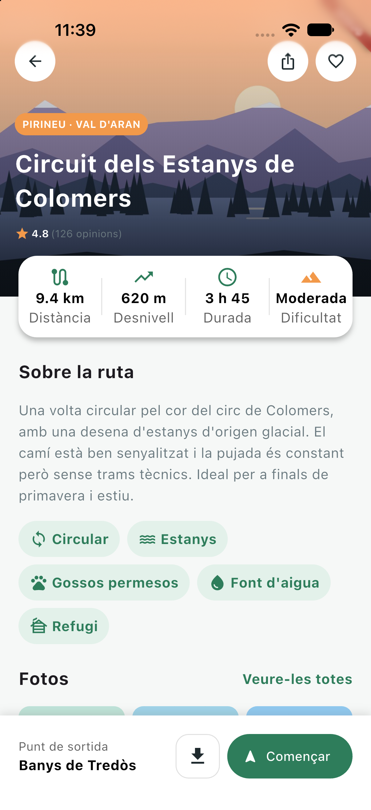
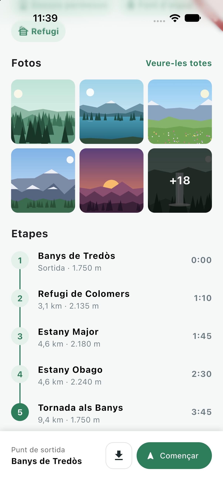

# Camins

Static trail-detail screen for a mountain-routes app, built with Flutter.
Assessment Activity 1.3 · Module 1 · *Mobile App Development for iOS and Android with Flutter*.

The designer's mockup is a single screen, the detail sheet of a hiking route
("Circuit dels Estanys de Colomers"), and the goal was to rebuild it in code as
faithfully as possible. The screen is static: nothing reacts to taps, and the buttons use `onPressed: () {}`.

## Screenshots

<!-- Add your emulator/device captures: the start screen and the ones needed to see it fully when scrolling -->

| Start | Scroll 1 |
|-------|----------|
|  |  | !

## What is implemented

| Level | Zone | What | Widget(s) |
|-------|------|------|-----------|
| Base | 2 | Header image with region, title and rating on top (gradient for readability) | `TrailHeader` |
| Base | 3 | Stats card with 4 evenly distributed values | `TrailStatsCard`, `StatItem` |
| Base | 4 | "About" text and tags that wrap onto new lines | `TrailAbout`, `TagChip` |
| Base | 7 | Bottom bar that is always visible | `TrailBottomBar` |
| Extension | 5 | 3-column photo grid with rounded corners and "See all" title | `PhotosGrid` |
| Extension | 6 | Five stages with numbered circle, name, detail and time | `StagesList`, `StageTile` |
| Challenge | 1 | Three round buttons over the image | `HeaderButton` |
| Challenge | 2+3 | Stats card overlapping the header image | `Stack` + `Positioned` with `Clip.none` |
| Challenge | 5 | Last photo darkened with a "+18" overlay | `PhotosGrid` |
| Challenge | 6 | Vertical line joining the stage circles | `StageTile` |

## Project structure

```
lib/
├── main.dart                     # Entry point, MaterialApp
├── models/trail.dart             # Trail and Stage data (hardcoded sample route)
├── screens/trail_detail_screen.dart
├── styles/app_styles.dart        # Colors and separators
└── widgets/                      # One widget per file
    ├── header_button.dart
    ├── photos_grid.dart
    ├── stage_tile.dart
    ├── stages_list.dart
    ├── stat_item.dart
    ├── tag_chip.dart
    ├── trail_about.dart
    ├── trail_bottom_bar.dart
    ├── trail_header.dart
    └── trail_stats_card.dart
assets/images/                    # The 7 course illustrations
```

Colors and spacing always come from `AppStyles`, code identifiers are in English
and all visible texts are in Catalan, as required.

## Running it

```bash
flutter pub get
flutter run
```

## Reflection

### How I approached it
I went zone by zone, top to bottom, as the assignment suggested: first get
everything on screen, then fine-tune sizes and colors. I committed after each
zone, so the git history reads like the design itself (Zone 2, Zone 3, ...), and
that made it easy to go back when something broke. I did the three levels in
order: Base, Extension and, last, the Challenge details marked in red.

I kept a `NOTES.md` while working, writing down each error, its cause and
its fix. Most of what I learned is in there.

### What went well
- Splitting the screen into small widgets (`StatItem`, `TagChip`, `HeaderButton`,
  `StageTile`...) made repeated blocks trivial. For example, noticing the three
  header buttons were identical led me to extract `HeaderButton`.
- Moving the hardcoded texts into a `Trail` model and passing plain values
  (instead of a whole `Trail`) to the widgets made them more reusable and
  independent from the data. `TagChip` now receives an `IconData` for the same reason.
- Keeping all colors and spacings in `AppStyles` kept the code consistent.

### What went wrong (and what I learned)
- **Assets not found.** I had put `assets/` inside `lib/`. Flutter only looks for
  them at the project root.
- **Title overflowing the image.** The `Positioned` only had `left`, so the
  `Column` had no width limit and the text never wrapped. Adding `right` bounded it.
- **`VerticalDivider` filling the whole row.** It has no height of its own, so it
  takes everything its parent gives it. Wrapping it in a `SizedBox` fixed it.
- **Chips stretched to full width.** A `Row` defaults to `MainAxisSize.max`;
  `MainAxisSize.min` made them hug their content.
- **Grid with extra padding.** `GridView` adds a default padding. Setting my own
  overrides it.
- **Cropped photos.** Cells weren't square, so `BoxFit.cover` cut the images.
  `childAspectRatio: 1` fixed it.
- **"+18" overlay covering only part of the photo.** The `Stack` sized itself to
  the image; `StackFit.expand` made it fill the cell. I also met Dart's spread
  operator (`if (isLast) ...[...]`) for the first time.
- **Stats card hidden below the header.** Anything drawn outside a `Stack` is
  clipped by default; `clipBehavior: Clip.none` let it overlap.

The main idea that finally clicked is *constraints go down, sizes go up*: almost
every layout bug above was a widget not knowing how much space it had.

### What surprised me
<!-- Write this in your own words, e.g. how much of the work is understanding constraints rather than writing widgets. -->

### What I would change
- Format decimals the Catalan way (`9,4 km` instead of `9.4`) with a small utility.
- Turn `difficulty` into an `enum` and `time` into a proper duration, instead of
  Strings kept only for display.
- Make the photos grid scrollable/expandable, and build the layout
  responsively for other screen sizes.
- Move the sample data out of `models/trail.dart` into its own source, since
  it would come from an API in a real app.

### Status
Base, Extension and Challenge levels completed.